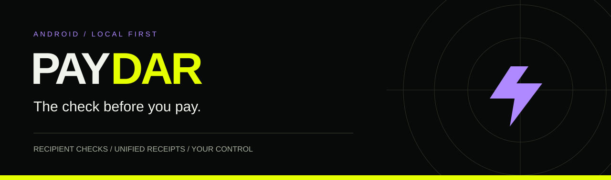
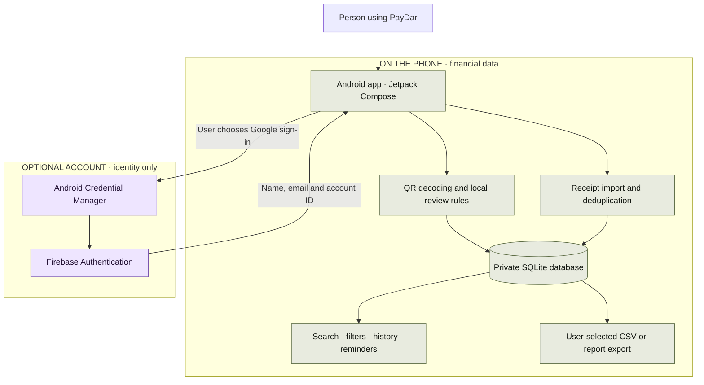
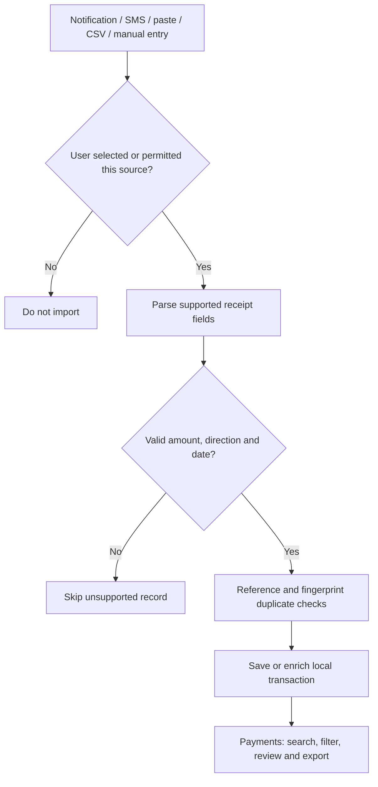
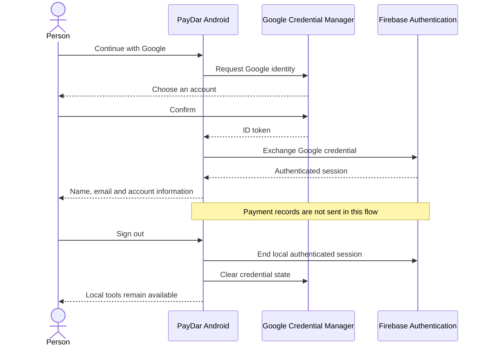
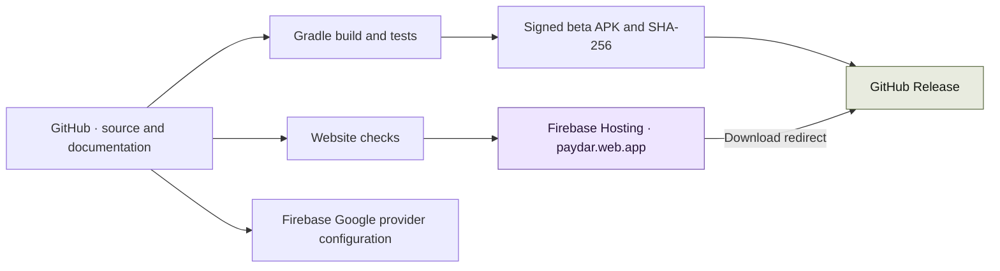

<p align="center"></p>

<p align="center">
  <a href="https://paydar.web.app"><strong>Live website</strong></a> ·
  <a href="https://github.com/hydra-eng/paydar/releases/tag/v0.3.0-beta"><strong>Download Android</strong></a> ·
  <a href="docs/FIREBASE-SETUP.md"><strong>Setup guide</strong></a> ·
  <a href="https://github.com/hydra-eng/paydar/issues"><strong>Report an issue</strong></a>
</p>

# PayDar

**A clearer view before and after a UPI payment.**

PayDar is an Android payment companion with a Three.js product website. Inspect UPI recipients, review local risk records, collect supported transaction receipts and prepare recovery reports. Optional Google sign-in uses Firebase Authentication; payment records stay on the device.

[Website](https://paydar.web.app) · [Android beta](https://paydar.web.app/downloads/PayDar-beta.apk) · [Privacy](https://paydar.web.app/privacy.html) · [Firebase setup](docs/FIREBASE-SETUP.md)

## At a glance

| Release | Platform | Storage | Authentication | Hosting |
| --- | --- | --- | --- | --- |
| **0.3.0 beta** | Android 8.0+ | Private SQLite | Optional Google / Firebase | Firebase Hosting |

**Explore:** [Capabilities](#product) · [Architecture](#architecture) · [Transaction flow](#transaction-flow) · [Account flow](#account-flow) · [Local setup](#run-locally) · [Deployment](#deployment-flow) · [Roadmap](#roadmap)

## Product

| Area | Available in the beta |
| --- | --- |
| ScanSafe | Camera/image QR decoding; recipient, amount and UPI address review |
| FraudCheck | Local imported risk records, source details and official suspect-search handoff |
| MuleGuard | Three-question educational assessment with explained signals |
| WrongPay Rescue | Local report drafts and user-initiated sharing to support channels |
| SubWatcher | SMS/pasted-message import, editable recurring entries and local reminders |
| Payments | Selected-app notifications, SMS, shared/pasted receipts, manual records and CSV import/export |
| Account | Google sign-in, profile details, sign-out and cloud account deletion |
| Website | Licensed 3D phone, scroll-driven walkthrough, keyboard controls and reduced-motion support |

PayDar does not move money, request UPI PINs, verify bank balances or retrieve every UPI app's complete history. Unsupported receipts may be missed. Missing risk records never mean a recipient is safe. Automated authoritative fraud feeds, physical QR tamper detection, on-device LLM inference and automatic dispute submission remain unfinished.

## Architecture



Authentication has no connection to the local financial database. Signing out or switching accounts does not remove or partition this installation's records. Delete cloud identity and local records independently.

## How a check works

```mermaid
flowchart LR
    scan["Scan QR or enter UPI ID"] --> parse["Decode and validate"]
    parse --> compare["Compare recipient details"]
    compare --> local["Review available local records"]
    local --> result["Show evidence and limitations"]
    result --> decision["User independently confirms recipient"]
    decision --> payment["Payment happens in the user's UPI app"]
    style result fill:#fff6ce,stroke:#927b19,color:#332c0c
    style payment fill:#eee5ff,stroke:#7955ae,color:#251436
```



PayDar stops at review and support. It never initiates a payment or treats an unknown recipient as safe.

## Transaction flow



No sample transactions are inserted into the app. Illustrative website previews are labelled as examples. Read [transaction formats and limitations](docs/TRANSACTIONS.md).

## Account flow



Cloud-account deletion requires confirming the same Google identity. It removes the Firebase user; local records are deleted separately. Signing in does not create a cloud backup.

## Technology

| Layer | Implementation |
| --- | --- |
| Android UI | Kotlin 2.4, Jetpack Compose, Material 3 |
| Local processing | Kotlin rules, ZXing, SQLite, StateFlow |
| Identity | Credential Manager, Google ID, Firebase Authentication |
| Website | HTML, CSS, Three.js, Anime.js, Lucide |
| Delivery | Firebase Hosting, GitHub Releases, Gradle |

## Run locally

### Website

Requires Python 3 or another static HTTP server. There is no bundler step.

```sh
python -m http.server 4173 --directory site/dist
node --test site/tests/walkthrough.test.mjs
```

Open `http://localhost:4173`. Libraries, fonts and model assets are served locally. Use HTTP rather than opening `index.html` with `file://`.

### Android

Requires JDK 17+, Android SDK 34 and the included Gradle wrapper. Set `ANDROID_HOME` or create an untracked `android/local.properties` pointing to your SDK.

```sh
cd android
# Windows: gradlew.bat
./gradlew testDebugUnitTest assembleDebug
```

APK output: `android/app/build/outputs/apk/debug/app-debug.apk`. The verified beta is committed as a repository asset because Firebase Spark Hosting excludes executable uploads. Update the stable raw URL in `site/dist/index.html` and the SHA-256 checksum for each new version. This is a debug-signed beta; production signing keys must remain private.

For Google sign-in on a build made with your own keystore, register its certificate in Firebase. See [setup and device checks](docs/FIREBASE-SETUP.md).

## Deploy

```sh
npx -y firebase-tools@latest login
npx -y firebase-tools@latest deploy --only auth,hosting --project paydar-hydra
```

The Firebase project is `paydar-hydra`; the public Hosting site is `paydar.web.app`. Deployment requires administrator access. Forks should use their own Firebase project and configuration.

## Deployment flow



These are the release steps, not an automated CI pipeline. The APK is hosted by GitHub because the free Firebase Spark plan does not permit executable uploads. No paid hosting plan is required for this arrangement.

## Repository structure

```text
android/       Native Android app, Gradle wrapper and unit tests
site/dist/     Deployable website, local libraries, fonts and 3D asset
site/tests/    Website controller tests
docs/          Feature limits, transaction formats and Firebase setup
firebase.json  Hosting and authentication configuration
```

## Design and accessibility

The PayDar deck defines the black, electric yellow and purple palette. Oswald headings and Manrope body text keep the visual hierarchy consistent across Android and web. Scroll motion follows native scrolling; reduced-motion settings retain controls and content. WebGL failure has a readable fallback. Product presentation draws on [Anime.js](https://animejs.com/) scroll timing and [Apple's layout guidance](https://developer.apple.com/design/human-interface-guidelines/layout), without copying their branding.

## Verification and release limits

Tests cover parsing, malformed inputs, duplicate handling, SQLite migration, deletion and the website walkthrough. Physical-device Google sign-in, notification delivery and full responsive browser QA require separate testing. See [validation](docs/VALIDATION.md). The beta is not a production fraud-protection guarantee or a Play Store release.

## Roadmap

| Priority | Next work | Current boundary |
| --- | --- | --- |
| Release readiness | Physical-device sign-in, permissions and accessibility checks | Unit tests do not verify device integrations |
| Trusted risk data | Licensed provider and authenticated offline updates | Current lists are imported and unverified |
| Receipt coverage | Broader parser fixtures and verified recurrence detection | Unsupported or redacted receipts may be missed |
| QR tamper detection | Validated model and field evaluation | Only QR decoding is available |
| Production distribution | Release signing, target-SDK updates and store permission review | Download is a debug-signed beta |

## Contributing and reporting problems

Include the device/browser version, steps to reproduce, expected result and actual result. Use fictional payment details in examples. Remove account identifiers and financial data from screenshots and logs. Never post passwords, OTPs, tokens or signing keys in an issue.

## Attribution

The phone model is by **MajdyModels**, distributed through [Phone Mockup Studio](https://github.com/quentin-pla/phone-mockup-studio/blob/main/CREDITS.md) under CC BY 4.0, with PayDar screen and material modifications. It illustrates the product; the app is Android-only. Three.js and Anime.js: MIT. Lucide: ISC. Manrope and Oswald: SIL OFL. License texts are in `site/dist/assets/licenses`; [full credits](https://paydar.web.app/credits.html).

Public source availability does not change third-party licenses. No additional blanket reuse license for PayDar branding and original source is granted by this repository.

