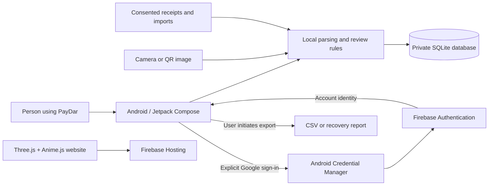
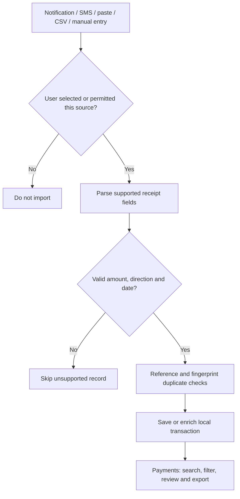

# PayDar

**The check before you pay.**

PayDar is an Android payment companion with a Three.js product website. Inspect UPI recipients, review local risk records, collect supported transaction receipts and prepare recovery reports. Optional Google sign-in uses Firebase Authentication; payment records stay on the device.

[Website](https://paydar.web.app) · [Android beta](https://paydar.web.app/downloads/PayDar-beta.apk) · [Privacy](https://paydar.web.app/privacy.html) · [Firebase setup](docs/FIREBASE-SETUP.md)

## Product

| Area | Available in the beta |
| --- | --- |
| ScanSafe | Camera/image QR decoding; recipient, amount and UPI address review |
| FraudCheck | Local imported risk records, source details and official suspect-search handoff |
| MuleGuard | Three-question educational assessment with explained signals |
| WrongPay Rescue | Local report drafts and user-initiated sharing to support channels |
| SubWatcher | SMS/pasted-message import, editable recurring entries and local reminders |
| Payments | Selected-app notifications, SMS, shared/pasted receipts, manual records and CSV import/export |
| Account | Google sign-in, profile details, sign-out and cloud account deletion |
| Website | Licensed 3D phone, scroll-driven walkthrough, keyboard controls and reduced-motion support |

PayDar does not move money, request UPI PINs, verify bank balances or retrieve every UPI app's complete history. Unsupported receipts may be missed. Missing risk records never mean a recipient is safe. Automated authoritative fraud feeds, physical QR tamper detection, on-device LLM inference and automatic dispute submission remain unfinished.

## Architecture



Authentication has no connection to the local financial database. Signing out or switching accounts does not remove or partition this installation's records. Delete cloud identity and local records independently.

## Transaction flow



No sample transactions are inserted into the app. Illustrative website previews are labelled as examples. Read [transaction formats and limitations](docs/TRANSACTIONS.md).

## Run locally

### Website

Requires Python 3 or another static HTTP server. There is no bundler step.

```sh
python -m http.server 4173 --directory site/dist
node --test site/tests/walkthrough.test.mjs
```

Open `http://localhost:4173`. Libraries, fonts and model assets are served locally. Use HTTP rather than opening `index.html` with `file://`.

### Android

Requires JDK 17+, Android SDK 34 and the included Gradle wrapper. Set `ANDROID_HOME` or create an untracked `android/local.properties` pointing to your SDK.

```sh
cd android
# Windows: gradlew.bat
./gradlew testDebugUnitTest assembleDebug
```

APK output: `android/app/build/outputs/apk/debug/app-debug.apk`. Publish it as a GitHub Release asset, then update the APK redirect in `firebase.json` and the SHA-256 checksum. Firebase Spark Hosting excludes executable uploads. This is a debug-signed beta; production signing keys must remain private.

For Google sign-in on a build made with your own keystore, register its certificate in Firebase. See [setup and device checks](docs/FIREBASE-SETUP.md).

## Deploy

```sh
npx -y firebase-tools@latest login
npx -y firebase-tools@latest deploy --only auth,hosting --project paydar-hydra
```

The Firebase project is `paydar-hydra`; the public Hosting site is `paydar.web.app`. Deployment requires administrator access. Forks should use their own Firebase project and configuration.

## Repository structure

```text
android/       Native Android app, Gradle wrapper and unit tests
site/dist/     Deployable website, local libraries, fonts and 3D asset
site/tests/    Website controller tests
docs/          Feature limits, transaction formats and Firebase setup
firebase.json  Hosting and authentication configuration
```

## Design and accessibility

The PayDar deck defines the black, electric yellow and purple palette. Oswald headings and Manrope body text keep the visual hierarchy consistent across Android and web. Scroll motion follows native scrolling; reduced-motion settings retain controls and content. WebGL failure has a readable fallback. Product presentation draws on [Anime.js](https://animejs.com/) scroll timing and [Apple's layout guidance](https://developer.apple.com/design/human-interface-guidelines/layout), without copying their branding.

## Verification and release limits

Tests cover parsing, malformed inputs, duplicate handling, SQLite migration, deletion and the website walkthrough. Physical-device Google sign-in, notification delivery and full responsive browser QA require separate testing. See [validation](docs/VALIDATION.md). The beta is not a production fraud-protection guarantee or a Play Store release.

## Attribution

The phone model is by **MajdyModels**, distributed through [Phone Mockup Studio](https://github.com/quentin-pla/phone-mockup-studio/blob/main/CREDITS.md) under CC BY 4.0, with PayDar screen and material modifications. It illustrates the product; the app is Android-only. Three.js and Anime.js: MIT. Lucide: ISC. Manrope and Oswald: SIL OFL. License texts are in `site/dist/assets/licenses`; [full credits](https://paydar.web.app/credits.html).

Public source availability does not change third-party licenses. No additional blanket reuse license for PayDar branding and original source is granted by this repository.

